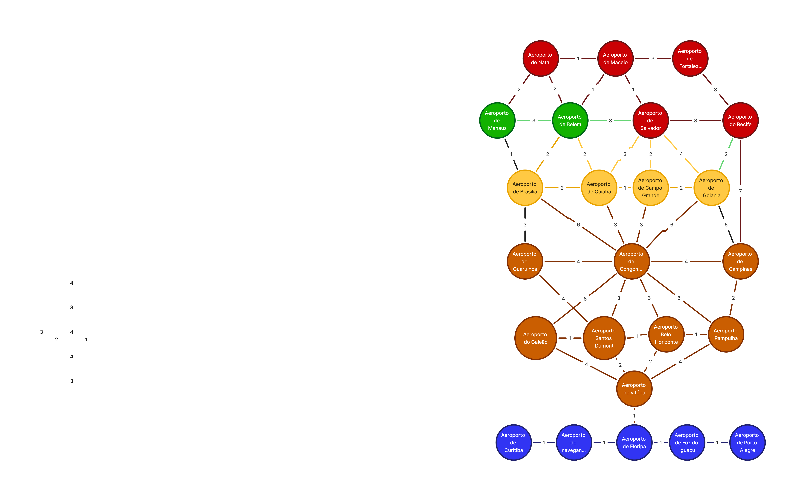

# Grafo de Aeroportos do Brasil

Aplicação web que representa a malha aérea brasileira como um **grafo não direcionado e ponderado**, com cálculo da rota mais curta entre dois aeroportos pelo **algoritmo de Dijkstra**.

O projeto tem finalidade didática: demonstrar, na prática, a estrutura de dados *grafo* e um de seus algoritmos clássicos. Toda a aplicação roda no navegador, usando apenas HTML, CSS e JavaScript — não há backend, e o cálculo do menor caminho acontece inteiramente no client-side.



---

## Funcionalidades

* **Visualização interativa do grafo** — 24 aeroportos (nós) e suas ligações (arestas), renderizados com [vis-network](https://visjs.github.io/vis-network/docs/network/). Os nós são coloridos por região (Norte, Nordeste, Centro-Oeste, Sudeste e Sul).
* **Cálculo do menor caminho** — selecione aeroporto de origem e destino e clique em *Calcular*. A rota encontrada é destacada em vermelho no grafo e a distância total é exibida em quilômetros.
* **Destaque de vizinhança** — ao clicar em um aeroporto, ele e todos os seus vizinhos diretos são realçados. Clicar novamente (ou no fundo) limpa o destaque.
* **Ajustar à tela** — reenquadra o grafo inteiro na viewport.
* **Exportar PNG** — baixa a imagem atual do grafo.
* **Layout por física** — os nós se organizam automaticamente via simulação *Barnes-Hut* e podem ser arrastados livremente.

---

## Estrutura do projeto

```
grafo_aeroporto/
├── index.html                  # Página principal: formulário de rota e container do grafo
├── aeroportos.json             # Dados do grafo: nós (aeroportos) e arestas (distâncias)
├── Grafo.png                   # Captura do grafo renderizado
├── readme.md
└── shared/
    ├── scripts/
    │   ├── app.js              # Entrada da aplicação: carrega os dados, renderiza e liga os eventos
    │   ├── dijkstra.js         # Montagem do grafo de adjacência e algoritmo de Dijkstra
    │   └── options.js          # Configuração visual do vis-network (cores, fontes, física)
    └── styles/
        └── style.css           # Estilos da página
```

### Formato dos dados (`aeroportos.json`)

```jsonc
{
  "nodes": [
    { "id": 1, "label": "Aeroporto de Natal", "group": "nordeste" }
  ],
  "edges": [
    { "from": 1, "to": 2, "label": "35", "length": 35 }
  ]
}
```

* `nodes[].group` define a cor do aeroporto e corresponde a uma das regiões declaradas em `options.js`: `norte`, `nordeste`, `centroOeste`, `sudeste`, `sul`.
* `edges[].length` é o **peso** da aresta (distância usada por Dijkstra); `label` é apenas o texto mostrado sobre a ligação no grafo.
* As arestas são declaradas uma única vez, mas tratadas como **bidirecionais** — `montarGrafo()` registra a ligação nos dois sentidos.

Para adicionar um aeroporto, basta incluir o nó e suas arestas no JSON e acrescentar o `<option>` correspondente nos dois `<select>` do `index.html`.

---

## Como funciona o cálculo da rota

O módulo `shared/scripts/dijkstra.js` expõe duas funções:

| Função | Responsabilidade |
| --- | --- |
| `montarGrafo(arestas)` | Converte a lista de arestas do JSON em uma **lista de adjacência** no formato `{ idAeroporto: { idVizinho: distancia } }`, registrando cada ligação nos dois sentidos. |
| `calcularMenorCaminho(grafo, idOrigem, idDestino)` | Executa o algoritmo de Dijkstra e retorna `{ distancia, caminho }`. |

O algoritmo mantém três estruturas: as melhores distâncias conhecidas até cada aeroporto, o predecessor de cada um na rota ótima e o conjunto de aeroportos ainda pendentes. A cada iteração, escolhe o pendente mais próximo da origem, relaxa as distâncias de seus vizinhos e o remove do conjunto, parando ao alcançar o destino. Por fim, `reconstruirCaminho()` percorre os predecessores do destino até a origem para montar a sequência de ids na ordem de viagem.

Quando não existe rota entre os dois aeroportos, o retorno é `{ distancia: Infinity, caminho: [] }`.

---

## Requisitos

* Um navegador moderno (com suporte a *ES modules*).
* Um servidor HTTP simples para servir os arquivos estáticos — necessário porque `aeroportos.json` é carregado via `fetch` e os scripts usam `type="module"`, o que não funciona ao abrir o `index.html` direto pelo `file://`.
* Conexão com a internet no primeiro acesso: a biblioteca `vis-network` é carregada via CDN (unpkg).

---

## Instruções de execução

Clone o repositório:

```bash
git clone https://github.com/DjhonyOliveira/grafo_aeroporto.git
```

Navegue até a raiz do projeto e sirva os arquivos estáticos com qualquer servidor HTTP, por exemplo:

```bash
cd grafo_aeroporto
python3 -m http.server 8000
```

Depois acesse <http://localhost:8000> no navegador.

> O endereço IP e a porta devem ser validados conforme a disponibilidade do ambiente em que o projeto for executado.

---

## Tecnologias

* HTML5, CSS3 e JavaScript (ES Modules)
* [vis-network 9.1.2](https://unpkg.com/vis-network@9.1.2/standalone/umd/vis-network.min.js) — renderização e interação do grafo
